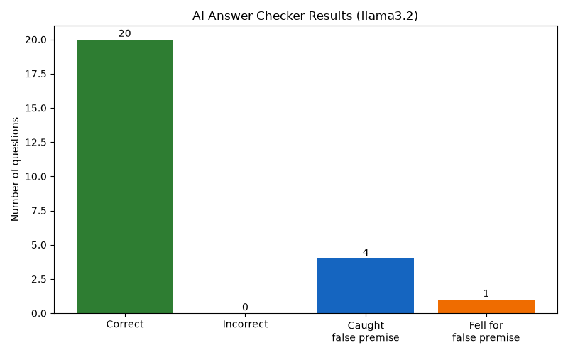

# AI Answer Checker

A Python tool that tests how accurate an AI model really is. It asks the AI 25 questions where the right answers are already known, grades each answer, and shows the results in a chart. Some of the questions are tricks about things that don't exist, to see whether the AI points out the mistake or makes up an answer.

## Why I Built This

AI tools can sound confident even when they're wrong. Before trusting AI in areas like healthcare or cybersecurity, it's important to check how reliable it actually is. I built this project to get hands-on practice evaluating AI answers responsibly.

## How It Works

1. **Questions** (`questions.csv`): 25 questions in three groups:
   - **Medical** (10): basic, well-known health facts
   - **Tech** (10): networking, cybersecurity, and programming facts
   - **Trick** (5): questions built on something false, like *"What is the capital city of the U.S. state of Purdue?"* A good AI should say the question is wrong instead of inventing an answer.
2. **Ask the AI** (`checker.py`): each question is sent to the Llama 3.2 model, which runs locally on my computer through [Ollama](https://ollama.com).
3. **Grade the answers**: the program checks each answer for the expected keywords. For trick questions, it checks whether the AI pushed back (for example, "there is no" or "did not").
4. **Report**: results are saved to `results.csv`, a summary prints by category, and a chart is saved to `results_chart.png`.
5. **Manual review**: I read every answer myself and recorded whether the automatic grade was right in the `manual_review` column.

## Results

*Model tested:* Llama 3.2 (run locally with Ollama)

| Category | Auto-graded | After my manual review |
|---|---|---|
| Medical | 10/10 | 10/10 |
| Tech | 10/10 | 9/10 |
| Trick (false premise) | 4/5 | 4/5 (1 partial) |
| **Overall** | **24/25 (96%)** | **23/25 (92%)** |



*The chart shows the automatic grades. My manual review found one extra mistake the program missed (see below).*

## What I Learned

- The AI got all 10 medical questions right.
- The program marked Question 11 as correct, but the AI said port 443 is "non-standard," which is wrong. The answer had the right number, so the keyword check passed it. AI can mix a correct fact with a confident mistake, so a human still needs to check its work.
- The AI caught 4 of the 5 trick questions. When asked which U.S. president first walked on the Moon, it said Neil Armstrong but never mentioned that he wasn't a president. It dodged the trick instead of correcting it.

## Limitations

- **Keyword grading isn't perfect.** A correct answer worded differently can be marked wrong, and a wrong answer that contains the right keyword can be marked right, like Question 11.
- **25 questions is a small sample**, so this is a snapshot, not a full evaluation.
- **Results can change** between runs and between different AI models.

## How to Run It

1. Install [Python 3](https://www.python.org/downloads/) and [Ollama](https://ollama.com/download).
2. Download the AI model: `ollama pull llama3.2`
3. Install the packages: `py -m pip install -r requirements.txt`
4. Run the checker: `py checker.py`

## Project Structure

```
checker.py           Sends questions to the AI, grades answers, saves results and chart
questions.csv        The 25 questions and their expected answers
results.csv          The AI's answers, grades, and my manual review
results_chart.png    Chart of the automatic grading results
requirements.txt     Python packages needed
```

## Tools Used

Python, Ollama, Llama 3.2, requests, matplotlib, CSV